# Atelier OAuth 2.0 et OpenID Connect

**Module :** Sécurité des systèmes distribués
**Étudiante :** Aicha
**École :** ENSET Mohammedia

## 1. Objectif

Sécuriser une application de gestion des demandes avec :

- **Keycloak** : serveur d'identité (port 8080)
- **Spring Boot** : API sécurisée (port 8081)
- **React** : application web (port 5173)

Il y a deux rôles :

- **USER** : créer une demande et voir ses demandes.
- **ADMIN** : voir toutes les demandes, valider ou refuser.

## 2. Technologies utilisées

| Outil | Version |
|---|---|
| Keycloak (Docker) | 26.8.1 |
| Spring Boot | 4.1.2 |
| Java | 21 |
| Maven | Maven Wrapper (`mvnw`) |
| React | Vite + `keycloak-js` |
| Tests API | Postman |

## 3. Structure du projet

```
atelier-oauth2/
├── docker-compose.yml
├── demandes-api/        (Spring Boot)
├── demandes-front/      (React + Vite)
├── screenshots/         (les captures d'écran)
└── README.md
```

## 4. Comment lancer le projet

1. Ouvrir Docker Desktop, puis : `docker compose up -d`
2. Dans `demandes-api` : `./mvnw spring-boot:run`
3. Dans `demandes-front` : `npm install` puis `npm run dev`
4. Ouvrir `http://localhost:5173`

Utilisateurs de test :

| Utilisateur | Mot de passe | Rôles |
|---|---|---|
| alice | alice123 | USER |
| bob | bob123 | USER, ADMIN |

*Note : à la première connexion, Keycloak demande un email, un prénom et un nom. J'ai mis des valeurs simples (par exemple `alice@test.com`).*

---

## 5. Séance 1 : Keycloak et Spring Boot

### 5.1 Lancer Keycloak avec Docker

Commande utilisée : `docker compose up -d`

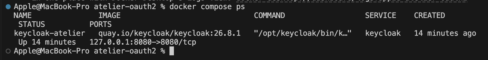
*Capture 1 : Keycloak est lancé (statut Up, port 8080).*

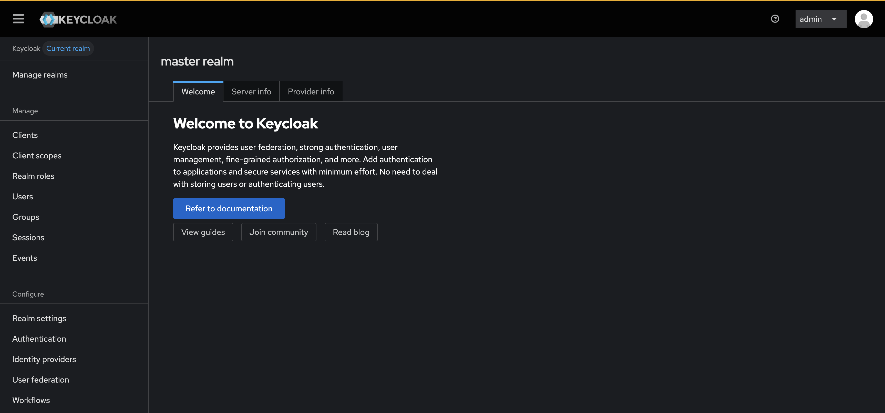
*Capture 2 : Console d'administration Keycloak.*

### 5.2 Créer le Realm

Nom du realm : `enset-realm`

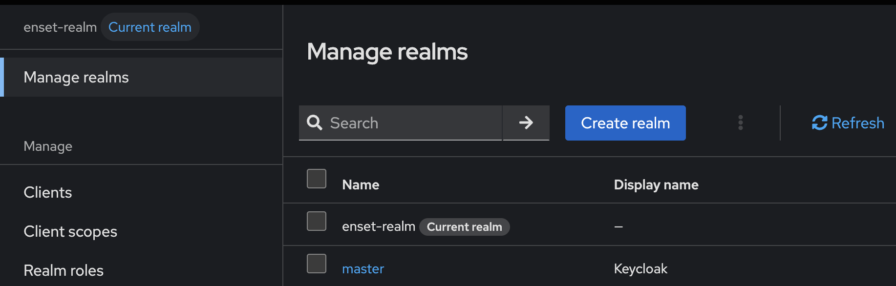
*Capture 3 : Le realm `enset-realm` est créé.*

### 5.3 Créer le client React

Réglages du client `react-client` :

- Client authentication : **Off** (React est un client public)
- Standard flow : **On**
- Implicit flow : **Off**
- Direct access grants : **Off**
- Root URL et Home URL : `http://localhost:5173/`
- Valid redirect URIs : `http://localhost:5173/*`
- Web origins : `http://localhost:5173`

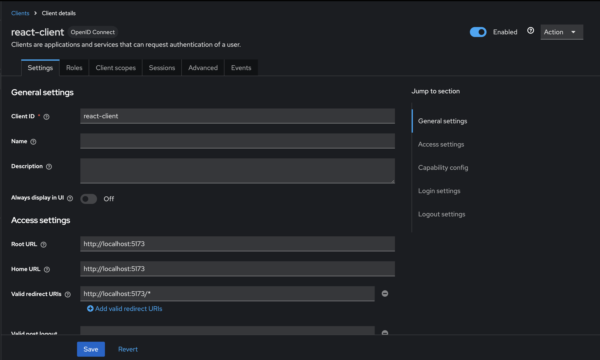
*Capture 4 : Configuration du client (URLs).*

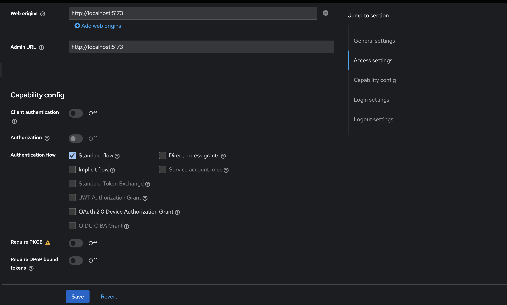
*Capture 4b : Capability config et Web origins.*

### 5.4 Activer PKCE

PKCE protège l'échange du code d'autorisation. Dans cette version de Keycloak, il se règle avec **Require PKCE** (méthode **S256**).

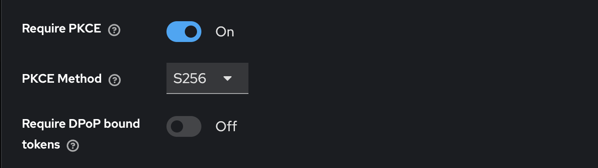
*Capture 5 : Require PKCE = On, méthode S256.*

### 5.5 Créer les rôles

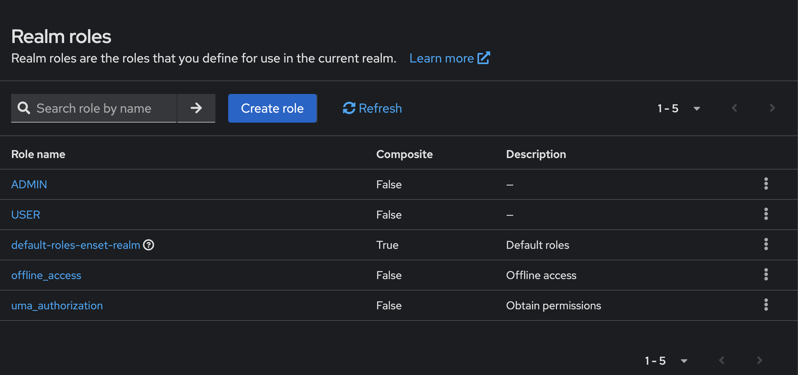
*Capture 6 : Les rôles USER et ADMIN.*

### 5.6 Créer les utilisateurs

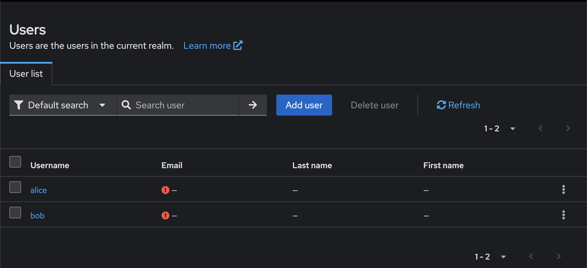
*Capture 7 : Les utilisateurs alice et bob.*

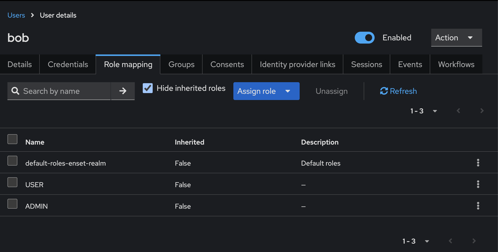
*Capture 8 : Bob a les rôles USER et ADMIN.*

### 5.7 Créer et lancer l'API Spring Boot

Le projet est créé avec Spring Web, Spring Security et OAuth2 Resource Server (Java 21, Spring Boot 4.1.2).

Fichiers principaux :

- `application.properties` : port 8081 et `issuer-uri` de Keycloak
- `SecurityConfig.java` : règles de sécurité, rôles Keycloak, CORS
- `DemandeController.java` : les endpoints de l'API

Test de l'API publique :

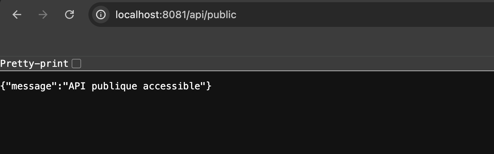
*Capture 9 : `/api/public` répond avec un message.*

Test d'une API protégée sans token :

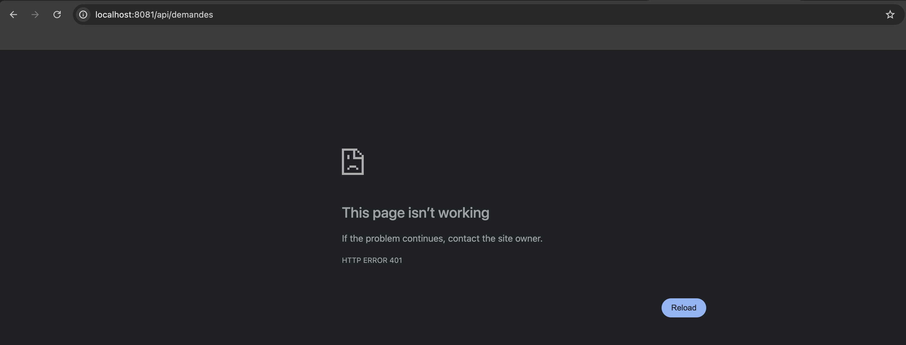
*Capture 10 : `/api/demandes` sans token donne une erreur 401.*

---

## 6. Séance 2 : React et OpenID Connect

### 6.1 Créer le projet React

Commandes : `npm create vite@latest demandes-front -- --template react`, puis `npm install keycloak-js`.

Fichiers principaux :

- `keycloak.js` : configuration de Keycloak
- `main.jsx` : connexion obligatoire avec PKCE S256
- `api.js` : appels à l'API avec le token (`Authorization: Bearer`)
- `App.jsx` : l'interface
- `App.css` : le style

### 6.2 Connexion avec Keycloak

Quand on ouvre `http://localhost:5173`, React envoie l'utilisateur vers Keycloak.

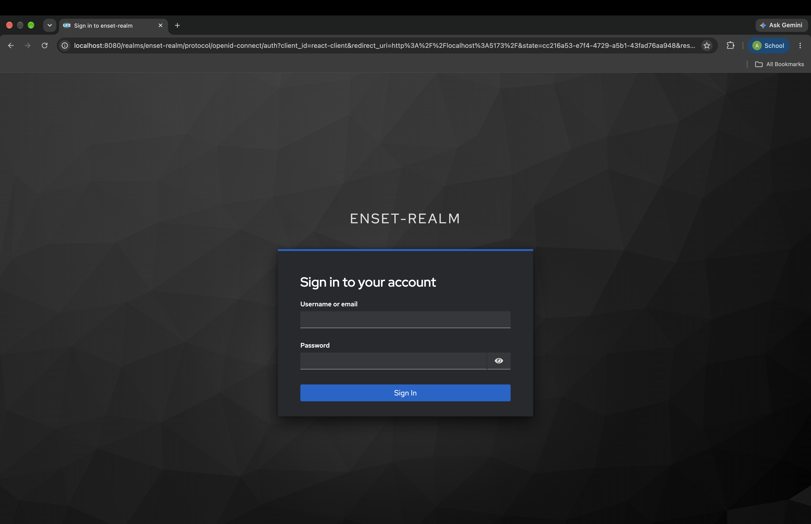
*Capture 11 : Page de connexion Keycloak (`enset-realm`).*

---

## 7. Tests fonctionnels et de sécurité

### Test 1 : Alice (USER)

Alice peut créer une demande et voir ses demandes. Le panneau Administration n'est pas visible.

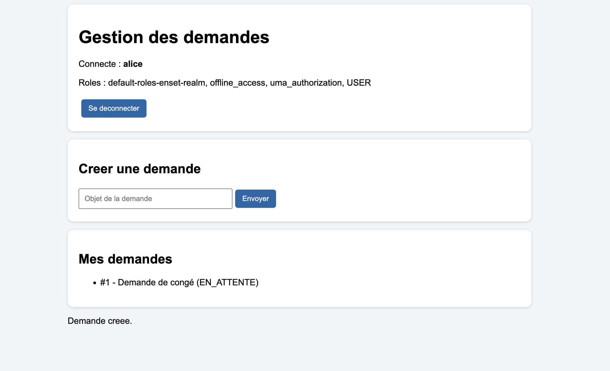
*Capture 12 : Interface d'Alice.*

### Test 2 : Bob (ADMIN)

Bob voit le panneau Administration. Il voit toutes les demandes et peut les valider.

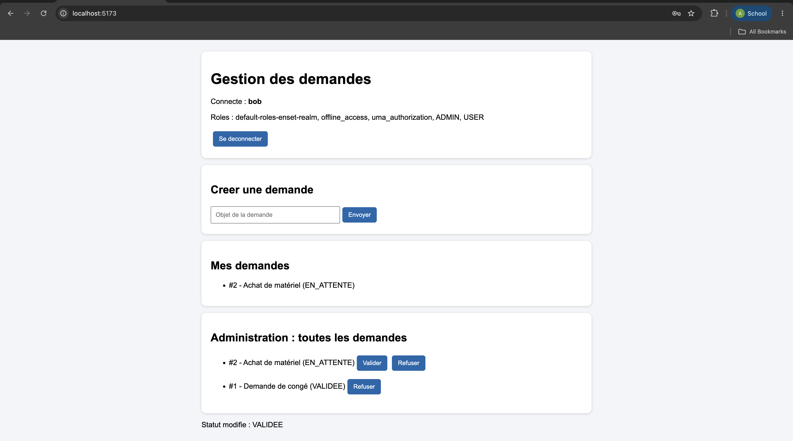
*Capture 13 : Interface de Bob avec le panneau Administration.*

### Test 3 : Access Token dans la requête

React envoie le token à Spring Boot dans l'en-tête `Authorization: Bearer ...`. La fin du token est cachée dans la capture.

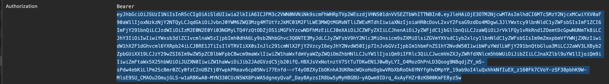
*Capture 14 : En-tête `Authorization: Bearer ...`.*

### Test 4 : API sans token

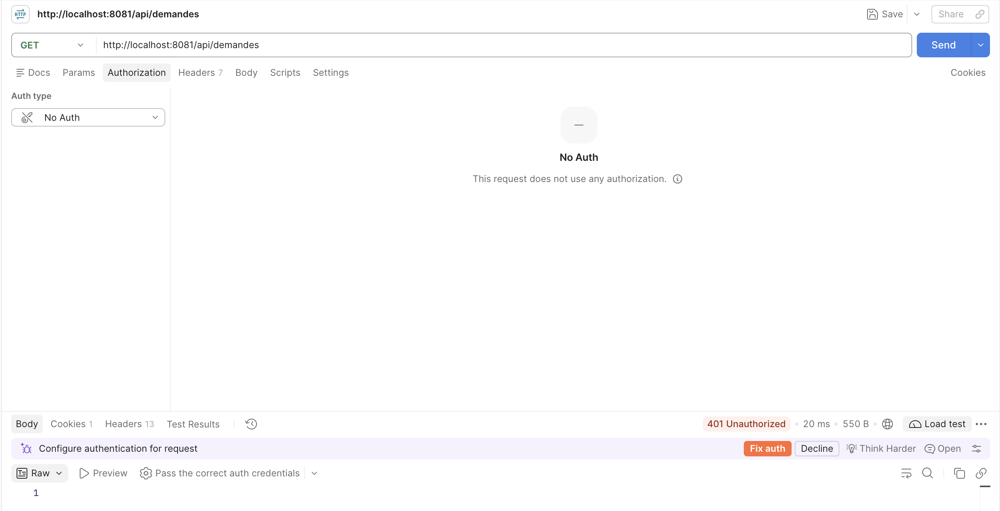
*Capture 15 : Sans token, résultat 401 Unauthorized.*

### Test 5 : Alice essaie l'accès ADMIN

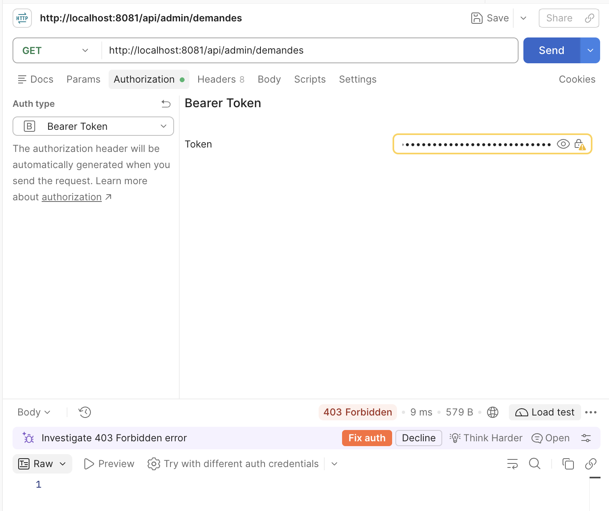
*Capture 16 : Alice sur `/api/admin/demandes`, résultat 403 Forbidden.*

### Test 6 : Bob accède à l'ADMIN

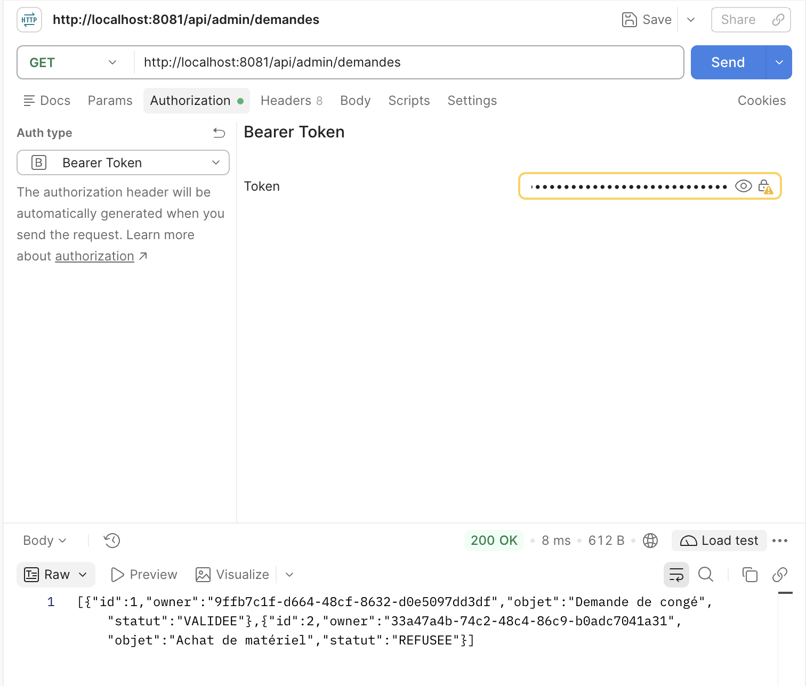
*Capture 17 : Bob sur `/api/admin/demandes`, résultat 200 OK.*

### Test 7 : Token invalide

J'ai changé un caractère du token avant de l'envoyer.


*Capture 18 : Token modifié, résultat 401 Unauthorized.*

### Résumé des tests

| Test | Résultat attendu | Résultat obtenu |
|---|---|---|
| Requête sans token | 401 | 401 Unauthorized |
| Token invalide | 401 | 401 Unauthorized |
| Alice (USER) sur l'API admin | 403 | 403 Forbidden |
| Bob (ADMIN) sur l'API admin | 200 | 200 OK |

---

## 8. Travail supplémentaire

### 8.1 Bouton Refuser

L'admin peut mettre le statut d'une demande à `REFUSEE`. Cette action est réservée au rôle ADMIN.

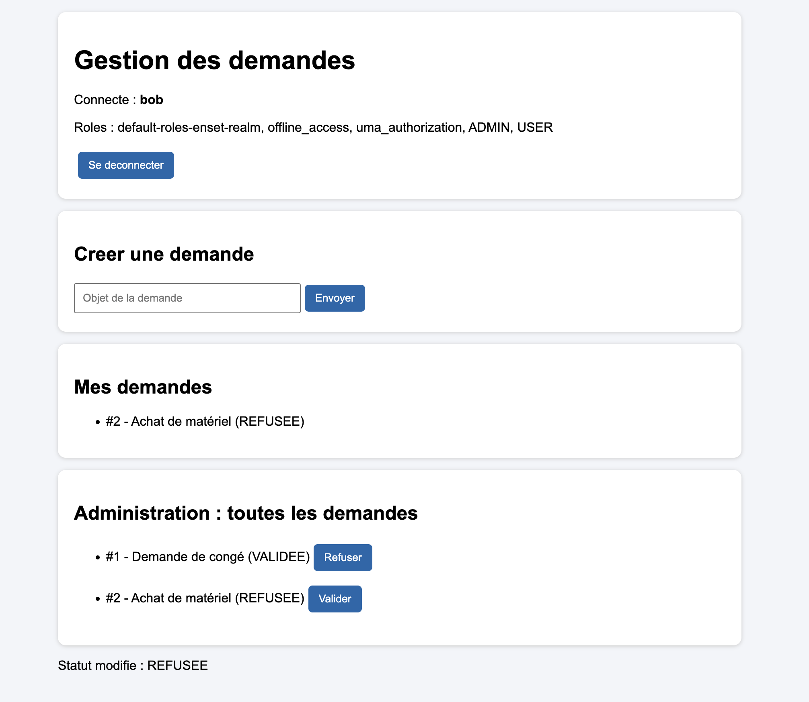
*Capture 19 : Le bouton Refuser et le statut REFUSEE.*

### 8.2 Endpoint `/api/profil`

`GET /api/profil` retourne l'identifiant (`sub`) et le nom d'utilisateur (`preferred_username`). Les données viennent du JWT.

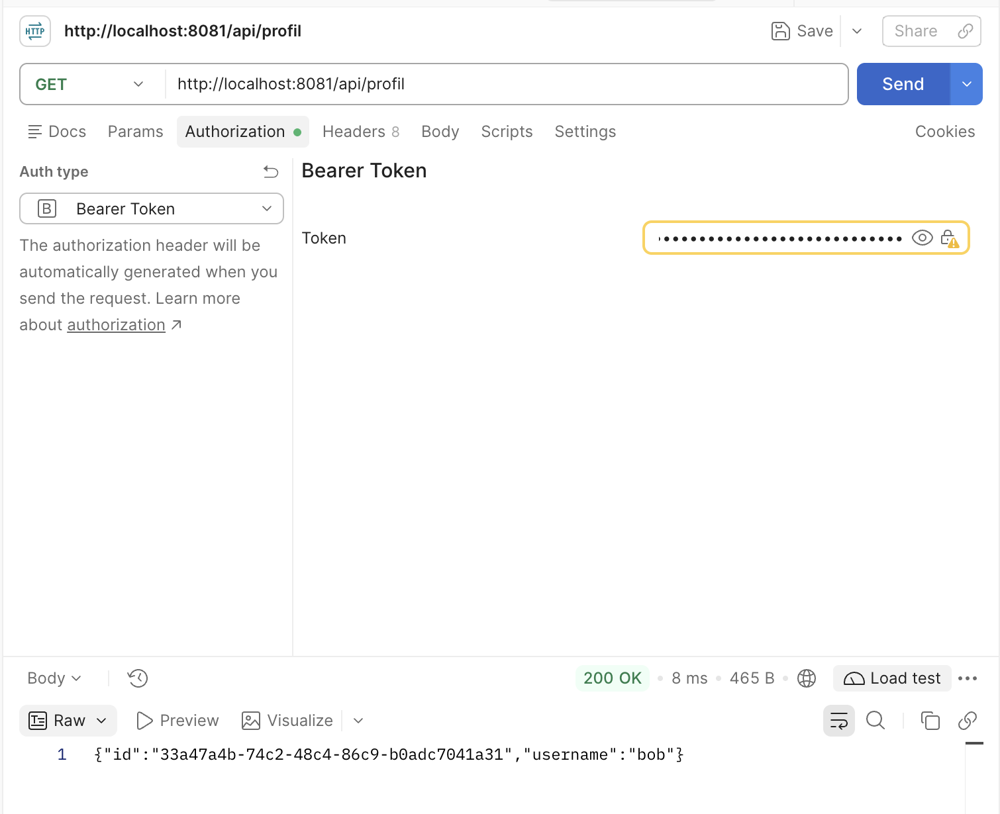
*Capture 20 : Résultat de `GET /api/profil` avec le token de Bob.*

### 8.3 Tests de sécurité

| Vérification | Preuve |
|---|---|
| Une requête sans token est refusée | Capture 15 |
| Une requête avec un token invalide est refusée | Capture 18 |
| Un USER ne peut pas utiliser l'API admin | Capture 16 |
| Un ADMIN peut modifier le statut | Captures 13, 17 et 19 |

---

## 9. Conclusion

- **Keycloak** est le serveur d'identité (Authorization Server et OpenID Provider).
- **React** est le client OAuth 2.0 / OpenID Connect.
- **Spring Boot** est le Resource Server : il vérifie les JWT.
- **Spring Security** applique les règles selon les rôles.

Cacher le panneau ADMIN dans React ne suffit pas. La vraie protection est dans le backend (Spring Security).

### Ce que j'ai appris

- Avec Keycloak, l'utilisateur se connecte sur Keycloak. Spring Boot ne vérifie plus les mots de passe : il vérifie seulement le token.
- PKCE rend la connexion plus sûre pour une application React, car React ne peut pas garder un secret.
- Les rôles (USER, ADMIN) sont dans le token JWT. Spring Security les utilise pour dire oui (200) ou non (403).
